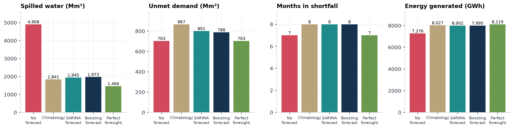
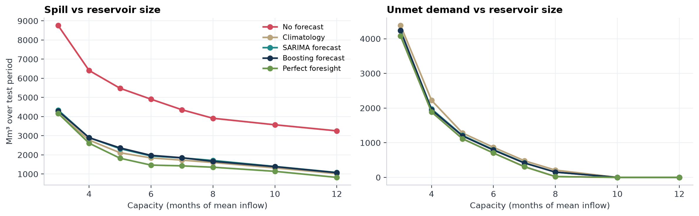

# Forecast-driven reservoir operation in the Lake Tana highlands


Ethiopia's reservoirs are its energy storage, and a rainfall forecast is a decision about when to release water.
This project asks three questions with open data (NASA POWER) and open-source Python:

1. **Predict, decide, test.** Does a monthly rainfall forecast let a reservoir operator spill less water and generate more energy than an operator who ignores forecasts?
2. **Backup.** When the rains fall short, how much of the hydropower gap can solar and wind fill?
3. **Battery.** Does a day-ahead solar forecast improve the nightly decision on how much to top a battery up for the evening peak?

Built as a prototype for the **IRENA Youth Forum 2027** theme: _Grids, Storage and Flexibility for Renewable Energy Systems_.




> **Status of results.** The repository ships code, tests and a notebook; running it regenerates every figure and table. The headline findings of the first run are summarised below.

## Run it

Tested with Python 3.11. A virtual environment keeps the dependencies separate from the rest of your machine.

```bash
python -m venv .venv
# Windows PowerShell:  .\.venv\Scripts\Activate.ps1
# macOS / Linux:       source .venv/bin/activate
pip install -r requirements.txt

python run.py                    # downloads NASA POWER once, caches it in data/, writes results/
jupyter notebook notebooks/lake_tana_storage.ipynb
pytest                           # 11 tests, including no-future-leakage checks
```

Change location or reservoir assumptions from the command line:

```bash
python run.py --lat 12.0 --lon 37.3 --cap-months 8 --demand-frac 0.75
```

`python run.py --no-battery` skips the daily-solar battery experiment (it needs 16 small extra downloads).

`python run.py --synthetic` runs on **fake** climate data, for checking the code offline. Its output goes to `results_synthetic/` and every figure is watermarked. Never report numbers from it.

## What it does

| Step    | Module              | What happens                                                                                                                                                                              |
| ------- | ------------------- | ----------------------------------------------------------------------------------------------------------------------------------------------------------------------------------------- |
| Data    | `tana/data.py`      | Monthly NASA POWER rainfall, solar irradiance and 50 m wind for one grid cell, 1990 to 2025, cached as CSV                                                                                |
| Predict | `tana/forecast.py`  | 1 to 3 month rainfall forecasts: seasonal naive, climatology, SARIMA (on square-root rainfall), gradient boosting. Rolling origin, refitted yearly, no future data                        |
| Decide  | `tana/reservoir.py` | Toy reservoir, inflow = lagged rainfall. Five release rules: no forecast, climatology, SARIMA, boosting, perfect foresight                                                                |
| Test    | `tana/reservoir.py` | Months in shortfall, unmet demand, spilled water, energy generated, plus a sensitivity to reservoir size                                                                                  |
| Backup  | `tana/backup.py`    | Solar and wind in the dry season and in weak rainy seasons; share of hydropower shortfall covered by a solar, wind or 50/50 portfolio                                                     |
| Battery | `tana/battery.py`   | Day-ahead solar forecasts (climatology, persistence, AR(1)) used to decide each night how much to top a battery up for the evening peak; compared with static rules and perfect foresight |

### The release rules

All rules must supply a firm monthly demand. The look-ahead rules also look 3 months ahead using a rainfall forecast. If the reservoir is projected to overflow, they release extra water through the turbines now (up to a turbine limit) instead of letting it spill later. They never cut supply below the firm demand. The _no forecast_ rule releases the demand and spills only when full. _Perfect foresight_ uses the true future rainfall and is an upper bound on what any forecast can achieve.

### How inflow, demand and energy are defined

- Inflow in month _t_ = scale x (0.35 R(t) + 0.40 R(t-1) + 0.25 R(t-2)), where R is monthly rainfall. The scale is calibrated so mean annual inflow equals an assumed value.
- Reservoir capacity and demand are sized relative to mean monthly inflow (`cap_months`, `demand_frac`), so conclusions are about the _operating rule_, not about a specific dam.
- Energy = water released x 0.245 GWh per million m3 (about 100 m head at 90% efficiency).
- Solar energy = MWp x peak sun hours x days x performance ratio (0.78). Wind energy integrates a power curve over a Weibull (k = 2) wind distribution at 100 m hub height.

## Outputs (written to `results/`)

- `figures/fig1_climate.png`: seasonal rainfall, sun and wind
- `figures/fig2_forecast_skill.png`: forecasts on held-out years and error by horizon
- `figures/fig3_reservoir_rules.png`: storage and spill under each rule
- `figures/fig4_scorecard.png`: shortfall, unmet demand, spill and energy by rule
- `figures/fig5_sensitivity.png`: how reservoir size changes the answer
- `figures/fig6_backup_conditions.png`: solar and wind in the dry season and in weak rainy seasons
- `figures/fig7_gap_cover.png`: share of the hydropower gap covered by solar and wind
- `figures/fig8_battery_days.png` to `fig11_battery_sensitivity.png`: a clear and a cloudy day, policy costs, cost by month, and sensitivity to PV size and overnight energy cost
- `results.md`, `summary.json`, `tables/*.csv`: every number behind the figures

## Findings from the first run (default settings, test years 2016 to 2025)

Reservoir: capacity 1,900 Mm3 (6 months of mean inflow), firm demand 253 Mm3/month. All figures are from a toy reservoir at one grid cell.

| Release rule           | Shortfall months | Unmet (Mm3) | Spill (Mm3) | Energy (GWh) |
| ---------------------- | ---------------- | ----------- | ----------- | ------------ |
| No forecast            | 7                | 703         | 4,908       | 7,276        |
| Climatology look-ahead | 8                | 867         | 1,842       | 8,027        |
| SARIMA look-ahead      | 8                | 801         | 1,945       | 8,002        |
| Boosting look-ahead    | 8                | 788         | 1,973       | 7,995        |
| Perfect foresight      | 7                | 703         | 1,466       | 8,119        |

- **Looking ahead cut spill by about 60% and raised generation by about 10%**, capturing roughly 85 to 89% of what perfect foresight could.
- **The spill reduction holds across reservoir sizes.** From 3 to 12 months of mean inflow, the look-ahead rules cut spill by roughly 50 to 70% against no forecast (exact values in `tables/capacity_sensitivity.csv`). The extra unmet-demand cost of looking ahead is largest in small reservoirs and disappears at about 10 months of storage or more (`figures/fig5_sensitivity.png`).
- **The forecast models did not beat the seasonal average.** One-month SARIMA RMSE was 65.6 mm against 66.0 mm for climatology (+0.5% skill); gradient boosting was 8% worse. The gain comes from anticipating the rainy season, not from model skill.
- **The look-ahead rules had one more shortfall month** and 12 to 23% more unmet demand than the no-forecast rule, because early releases left less water in storage when a weak season arrived. Perfect foresight avoids this, so it is a forecast-error cost.
- **Solar and wind:** solar is about 12% higher in the dry season than in the rainy season (6.2 vs 5.5 kWh/m2/day); wind varies little (4.1 vs 3.9 m/s). Weak rainy seasons were not noticeably sunnier or windier than other years. In the long simulation, 100 MW of 50/50 solar and wind covers about 36% of the hydropower shortfall energy and 200 MW about 64%; the worst month would need roughly 478 MW.

## How to report it honestly

- **Skill is measured against climatology.** Monthly rainfall is strongly seasonal, so the long-run monthly average is a hard baseline. A small or negative gain is a valid finding.
- **The reservoir is a decision testbed, not a dam model.** Inflow, size, demand and plant are assumptions in `tana/config.py`. State them.
- **The test period is about 10 years.** Describe differences between rules; do not claim statistical significance.
- **Look-ahead rules mostly save spilled water.** With a firm demand, they cannot create water, so a change in shortfall months may be small or zero. The scorecard shows what actually happens.
- **NASA POWER is a satellite and reanalysis product on a coarse grid**, not a gauge record, and it does not resolve the lake itself. Treat it as a screening dataset.
- **Wind and solar results are screening-level.** They show the shape of the complementarity argument, not a plant design.

## Battery dispatch: what it is and what it is not

A battery next to solar PV is reserved for the evening peak. Solar usually charges it, but not on a cloudy day. The night before, the operator can top it up from hydropower. Topping up when the sun would have filled it wastes hydro energy; not topping up before a cloudy day pushes the evening peak back onto hydro. A day-ahead solar forecast sets the top-up. Cost = 2 x evening peak energy hydro must supply + 1 x overnight top-up energy. Policies: never top up, always top up, top up June to September, forecast-aware (three forecasts), and perfect foresight.

This is the weakest part of the project, so state the limits plainly:

- **The load profile is synthetic.** Plant, battery and feeder sizes are assumptions in `tana/config.py` (`BatteryConfig`).
- **Hourly solar is a clear-sky bell scaled to the real NASA daily total.** Cloud variability within a day is not modelled.
- **The daily solar record is real NASA POWER data**, so the forecast skill numbers and the cloudy-day frequency are real.
- **Static rules are strong baselines.** The sensitivity figure shows when forecasts help and when they do not. Report that figure with the headline number.
- A forecast-aware rule can lose to a static rule: if overnight energy is nearly free (hydro would otherwise spill), always topping up wins.

### Result on NASA POWER data (2016 to 2025)

At the default size (40 MWp solar, 50 MWh battery) a day-ahead AR(1) solar forecast reduced daily irradiance error by 14% against climatology (RMSE 0.704 vs 0.820 kWh/m2/day) but did not improve the top-up decision: its cost was within 0.1% of never topping up, and perfect foresight beat the best static rule by only 3.1%.

The sensitivity analysis shows why. Forecasts help only when solar is undersized relative to the battery: at 20 MWp the AR(1) forecast saves about 9% and climatology about 8.5% (perfect foresight 13%); at 30 MWp the savings fall to about 3% and 1% (perfect foresight 11%); from 40 MWp upward the saving is zero because the sun fills the battery on most days. Across overnight energy costs, a real forecast captured only about a tenth of the gain from perfect foresight.

The load is synthetic and NASA POWER daily solar is a smoothed 0.5 degree product, so treat this as a test of decision logic, not plant performance.

## Project layout

```
run.py                     command-line entry point
tana/config.py             every assumption in one place
tana/data.py               NASA POWER download and cache
tana/forecast.py           rolling-origin rainfall forecasts
tana/reservoir.py          inflow model, release rules, simulator
tana/backup.py             solar and wind backup analysis
tana/battery.py            battery dispatch and day-ahead solar forecasts
tana/plotting.py           figures
tana/pipeline.py           orchestration and results writer
notebooks/                 walk-through notebook
tests/test_core.py         mass balance, calibration, no-leakage, units, battery energy balance
.github/workflows/ci.yml   tests and a synthetic-data smoke run on every push
```

## Data

NASA Prediction Of Worldwide Energy Resources (POWER), monthly and daily point API, parameters `PRECTOTCORR`, `ALLSKY_SFC_SW_DWN`, `WS50M`. Please cite NASA POWER when you publish.

## License

MIT. See `LICENSE`.
